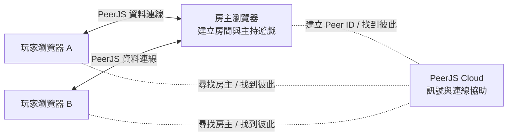

# PeerJS 線上房間功能說明

- **適用遊戲版本：** 0.2.0
- **文件版本：** 0.2.1
- **功能狀態：** 實驗版
- **最後整理：** 2026-11-24

這份文件說明《盲點輪廓－翻面之前》0.2.0 版的 PeerJS 線上房間原型。它同時提供第一次使用者的操作步驟，以及方便後續維護的技術架構、訊息格式與狀態流程。

## 先看這裡：一般玩家怎麼使用

線上遊戲需要至少兩台裝置。所有人先開啟同一個 GitHub Pages 遊戲網址，並且都能連上網路。

### 房主操作

1. 在首頁按 `PLAY`。
2. 選擇「線上房間實驗版」。
3. 輸入自己的暱稱，角色維持「建立房間」。
4. 選擇這一局的題數與分類。這些設定由房主決定。
5. 按「建立／加入房間」。
6. 畫面出現 6 位英數字母房間代碼，例如 `AUNHIG`。
7. 把這組代碼傳給朋友。先不要離開頁面，也不要關閉分頁。
8. 等待朋友加入。確認狀態顯示已連線後，再按「開始這局」。

建立房間後，按鈕會從「建立／加入房間」變成「開始這局」。第一次按鈕是建立房間，第二次按鈕才是開始遊戲。

### 其他玩家操作

1. 開啟同一個遊戲網址，按 `PLAY`。
2. 選擇「線上房間實驗版」。
3. 輸入自己的暱稱。
4. 將「線上角色」改成「加入房間」。
5. 在出現的「房間代碼」欄位輸入房主提供的 6 位代碼。
6. 按「加入房間」。
7. 看到「已連上房間，等待房主開始遊戲」後，等待房主按「開始這局」。

玩家端不需要自行選擇與房主相同的題數或分類；真正開始遊戲後，題目清單會由房主同步過來。

### 開始遊戲後

每一位玩家都會在自己的裝置看到同一題盲點句。每個人各自輸入第一直覺，按「鎖定答案」或「略過本題」。房主會等所有已連線玩家完成作答，再按「翻面揭曉」。揭曉結果與分數會同步到所有玩家的畫面。

每一題揭曉後，只有房主可以按「下一題」。玩家端看到「等待房主進入下一題」是正常狀態，不是錯誤。

## 一句話理解架構

這不是一個有中央遊戲伺服器的多人遊戲，而是「**房主瀏覽器當主持人，其他玩家瀏覽器透過 PeerJS 連到房主**」。PeerJS Cloud 只協助瀏覽器找到彼此並建立連線；遊戲題目、答案和分數由房主的頁面在連線中同步。



連線建立後，正常遊戲資料不需要經過本專案自架的後端。0.2.0 採用房主星狀拓撲：玩家不直接互相連線，所有玩家的答案先送到房主，再由房主廣播揭曉結果。

## 系統元件

### `index.html`

- 載入固定版本的 PeerJS CDN：`peerjs@1.5.4`。
- 提供「線上房間實驗版」模式按鈕。
- 提供暱稱、建立／加入角色、房間代碼與連線狀態欄位。
- 不包含後端 API 或登入系統。

### `app.js`

線上功能集中在 `state.online` 與下列函式：

- `setupOnlineHost()`：建立房主 Peer、產生房間代碼、接收玩家連線。
- `setupOnlineGuest()`：建立玩家 Peer，依房間代碼連到房主。
- `onlinePlayers()`：組合房主與目前已連線玩家，並保留累計分數。
- `sendOnline(message)`：房主廣播給所有玩家，或玩家回傳給房主。
- `handleOnlineMessage(message, connection)`：依 `message.type` 處理加入、作答、題目、揭曉與結束事件。
- `startOnlineGame()`：由房主建立題目清單並開始第一回合。
- `startOnlineRound()`：清空該回合答案，將題目與玩家清單同步出去。
- `recordOnlineAnswer()`：房主保存每位玩家的答案與輔助分數。
- `maybeEnableOnlineReveal()`：確認所有玩家完成後，顯示房主的揭曉按鈕。
- `revealQuestion()`：房主計分、更新畫面並廣播揭曉結果。
- `nextQuestion()`：只有房主能推進回合。

### PeerJS Cloud

PeerJS Cloud 在本原型中扮演訊號服務角色。房主使用固定格式的 Peer ID，例如 `bf-aunhig`；玩家先建立自己的暫時 Peer，再使用房間代碼連到房主的 Peer ID。連線成功後，實際遊戲訊息透過 PeerJS data connection 傳送。

因此，PeerJS Cloud 不保存本遊戲的題目、答案或分數，也沒有本專案的房間資料庫。房主分頁關閉後，房間就會失效。

## 連線與狀態流程

### 1. 建立房間

```text
房主選擇線上模式
  → setupOnlineHost()
  → 產生 6 位房間代碼
  → 建立 Peer("bf-<小寫代碼>")
  → Peer open
  → 顯示房間代碼
```

房間代碼是瀏覽器端用 `Math.random()` 產生的 6 位英數字串。它主要用來組合目前房主的 Peer ID，不是安全密碼，也沒有永久保留。

### 2. 玩家加入

```text
玩家輸入代碼
  → setupOnlineGuest()
  → 建立暫時 Peer
  → peer.connect("bf-<代碼>")
  → connection open
  → 傳送 { type: "join", name }
  → 房主登記 connection.peer 與玩家暱稱
  → 房主回傳 lobby 玩家清單
```

房主會為每條連線保存 `connection.playerName`，並將連線放進 `state.online.connections`。玩家端收到 `lobby` 後，只顯示已連線與等待開始的狀態。

### 3. 房主開始遊戲

```text
房主按「開始這局」
  → buildPlaylist()
  → 建立 state.playlist
  → 建立 state.players
  → startOnlineRound()
  → 廣播 question
  → 所有裝置進入作答畫面
```

房主的題數與分類設定會決定 `state.playlist`。玩家端收到 `question` 後，會暫時把收到的單題放入自己的 `state.playlist`，所以玩家不需要事先取得完整題庫選擇結果。

### 4. 玩家提交答案

房主和玩家使用不同路徑：

- 房主提交：直接呼叫 `recordOnlineAnswer("host", ...)`。
- 玩家提交：傳送 `answer` 訊息給房主，房主依 `connection.peer` 辨識玩家。

玩家提交後會進入鎖定畫面，不能重複送出。房主收到每一份答案後，檢查 `state.players` 中的每個玩家是否都有答案。只有全部完成時，房主才會看到可用的「翻面揭曉」按鈕。

### 5. 揭曉與分數同步

```text
房主按「翻面揭曉」
  → 確認所有玩家已作答
  → renderScores()
  → 更新每位玩家累計分數
  → 廣播 reveal
  → 所有玩家顯示完整情境、解析與分數
```

`scoreAnswer()` 會依題目的誤導關鍵詞與核心轉折點給出 0／1／2 分輔助建議。這不是不可更改的裁判結果；揭曉畫面仍可由房主調整分數。略過題目會記錄為「本題略過，不列入直覺判定」。

### 6. 下一題與結束

揭曉後，只有房主能按「下一題」。房主增加 `state.questionIndex`，再執行 `startOnlineRound()`。所有玩家收到下一個 `question` 後重新作答。

當題目清單用完時，房主廣播 `end`，所有裝置進入總結頁。房主是目前線上模式的遊戲主持者，因此玩家端不能自行跳題或結束遊戲。

## 目前使用的訊息格式

所有訊息都是透過 PeerJS data connection 傳送的 JavaScript 物件，核心欄位是 `type`。

### `join`：玩家 → 房主

```js
{
  type: "join",
  name: "玩家暱稱"
}
```

### `lobby`：房主 → 玩家

```js
{
  type: "lobby",
  players: [
    { id: "host", name: "房主", score: 0 },
    { id: "<peer id>", name: "玩家 A", score: 0 }
  ]
}
```

### `question`：房主 → 所有玩家

```js
{
  type: "question",
  question: { /* 題庫中的完整題目物件 */ },
  round: 1,
  total: 10,
  players: [ /* 本局玩家與累計分數 */ ]
}
```

### `answer`：玩家 → 房主

```js
{
  type: "answer",
  answer: "玩家輸入的文字",
  timedOut: false,
  skipped: false
}
```

玩家 ID 不放在訊息內容裡，而是由房主使用該 PeerJS connection 的 `connection.peer` 取得，避免玩家自行冒充其他連線 ID。

### `reveal`：房主 → 所有玩家

```js
{
  type: "reveal",
  question: { /* 目前題目 */ },
  players: [ /* 更新後的累計分數 */ ],
  answers: [ /* 每位玩家的答案、分數、命中線索與狀態 */ ]
}
```

### `end`：房主 → 所有玩家

```js
{ type: "end" }
```

## 重要狀態

| 狀態 | 用途 |
| --- | --- |
| `state.mode` | 判斷目前是單人、聚會或線上模式。 |
| `state.online.role` | `host` 或 `guest`，決定誰能開始、揭曉與推進回合。 |
| `state.online.peer` | 本裝置的 PeerJS `Peer` 物件。 |
| `state.online.connection` | 玩家端通往房主的單一資料連線。 |
| `state.online.connections` | 房主端保存所有玩家資料連線的 `Map`。 |
| `state.online.players` | 線上模式的玩家快照。 |
| `state.online.answers` | 房主端目前回合已收到的答案 `Map`。 |
| `state.playlist` | 房主的完整本局題目清單；玩家端每次只放入同步收到的目前題目。 |
| `state.players` | 畫面計分與玩家名稱使用的目前玩家清單。 |

## 錯誤與降級行為

- PeerJS CDN 沒有載入時，線上模式會顯示錯誤提示，單人與同裝置模式仍可使用。
- 房間代碼不是 6 位英數字時，玩家端不會嘗試連線。
- 房主或玩家收到 PeerJS error 時，介面會顯示建立或加入失敗訊息。
- 連線關閉時，房主會更新目前連線人數；玩家會看到連線中斷提示。
- 玩家端不能在房主尚未揭曉或尚未進入下一題時自行推進流程。

## 0.2.0 的明確限制

1. **房主必須在線。** 房主分頁關閉、重新整理或網路中斷，現有房間沒有接手機制。
2. **沒有斷線重連。** 玩家斷線後，目前需要重新加入；已送出的狀態不保證恢復。
3. **沒有房主轉移。** 房主不能把主持權交給其他玩家。
4. **沒有房間密碼或身分驗證。** 6 位代碼只是連線識別方式，不是安全認證。
5. **沒有持久化紀錄。** 題目、答案、分數只存在各瀏覽器的記憶體中。
6. **房主是唯一流程權威。** 玩家端不能獨立修改回合、題目或其他玩家的分數。
7. **依賴第三方 PeerJS Cloud。** 若 CDN 或 PeerJS 訊號服務不可用，線上模式就無法建立新連線，但單機模式的靜態遊戲仍可運作。

## 後續可擴充方向

- 加入心跳、重新加入與目前回合快照，改善斷線恢復。
- 由房主產生一次性房間邀請連結，減少手動輸入錯誤。
- 增加房主移交與主持人重新選舉。
- 對訊息加入回合編號、訊息序號與版本欄位，避免延遲訊息污染新回合。
- 若未來需要跨裝置長期紀錄或防作弊，再評估加入輕量後端與資料庫；目前不必為原型先架設複雜後端。
